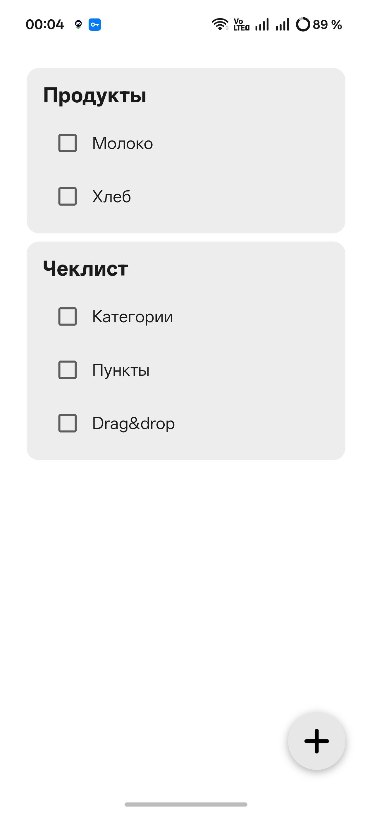
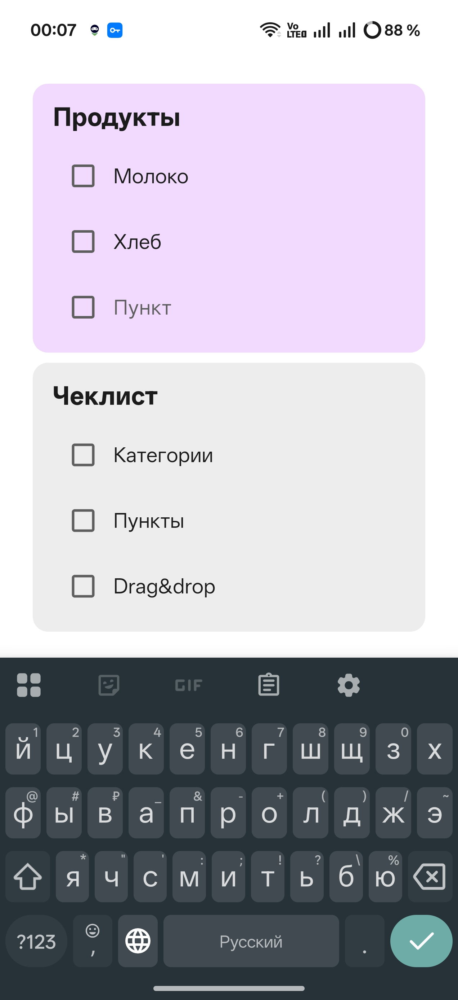
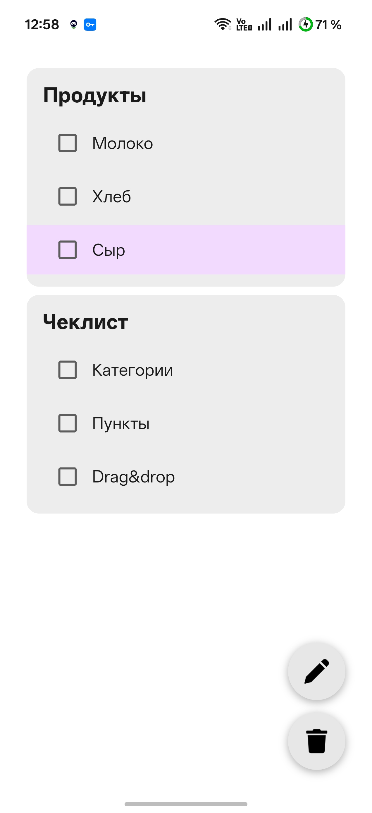
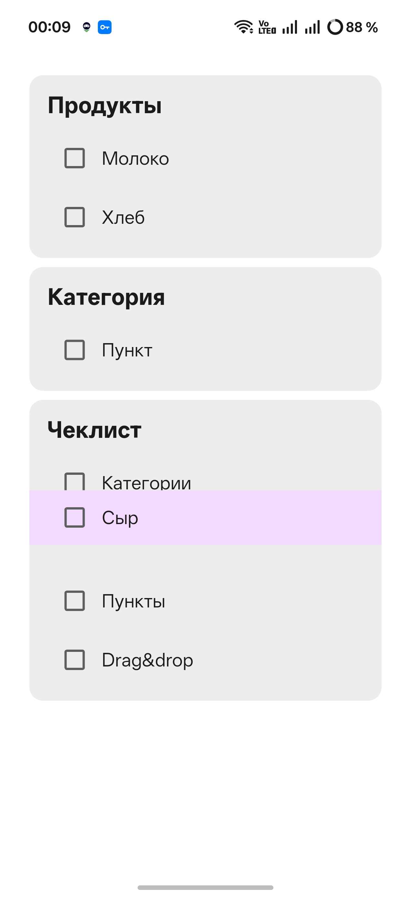

# Описание
`my-checklist` - это мобильное приложение для хранения чеклиста с возможностью разделять пункты на группы

# Демонстрация
Приложение состоит из объектов двух типов: пунктов и категорий. Пункты - сами записи с чекбоксами, которые можно отмечать или с которых можно снимать отметку. Категории - группы, на которые разделяются пункты.

Пункты могут существовать только в рамках какой-то категории. Изначально пользователю доступно только создание новых категорий. Во время добавления категории ей можно задать название.

 

Категории можно выделять долгим нажатием. После выбора категории пользователю предоставляется возможность переименовать или удалить категорию, а также добавить в нее новый пункт.

 

Во время добавления пунктов им тоже можно задать название.

Пункты тоже можно выделять долгим нажатием. Также пункт можно выбрать простым тапом, если он находится внутри выделенной категории. Выбранный пункт можно переименовать или удалить. У пунктов можно менять состояние отметки.

 

Повторное долгое нажатие по выделенным категориям или пунктам позволяет начать их перетаскивание. Таким образом можно менять порядок категорий и пунктов, а также перемещать пункты из одной категорию в другую.

 
